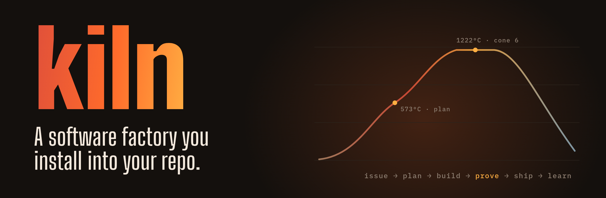

<p align="center"></p>

[](https://github.com/pavelsimo/kiln/releases)
[](LICENSE)
[](https://go.dev)
[](https://pavelsimo.github.io/kiln)

Hand kiln a task and your coding agent takes it from a GitHub issue to a merged pull request: it plans, builds in its own worktree, proves the change works on the real app, reviews it, ships it, and writes down what it learned. Kiln works with Claude Code, Codex and Cursor, and everything it remembers lives in your repo where you can read it in a diff.

It comes in two parts. **Skills** handle anything that needs judgment. A small **binary** answers everything git and gh can answer exactly, so no agent can talk itself past red CI.

## Install

```bash
brew install pavelsimo/tap/kiln
# or: go install github.com/pavelsimo/kiln@latest
```

## Quick start

```bash
kiln init                                   # in your repo: skills, config, labels, templates
```

Then, in your agent:

```text
/kiln-onboard                               # kiln learns your stack and how to run your app
/kiln "add a dark mode toggle to settings"  # issue → plan → build → verify → PR → merge
```

Kiln stops for you twice by default: before it writes any code, and before it merges.

## Learn more

- [Get started](https://pavelsimo.github.io/kiln/getting-started.html): install, onboard, first task
- [Tutorial](https://pavelsimo.github.io/kiln/tutorial.html): a first week with kiln
- [Concepts](https://pavelsimo.github.io/kiln/concepts.html): stages, gates, verification, memory
- [Skills](https://pavelsimo.github.io/kiln/skills.html): all 21 skills and the six playbooks
- [CLI reference](https://pavelsimo.github.io/kiln/cli.html): every command, flag and exit code

## License

[MIT](LICENSE)
